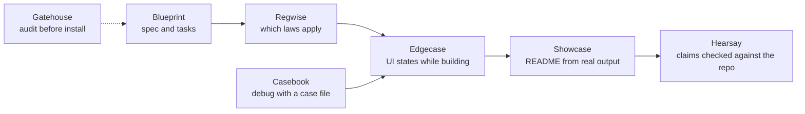

<div align="center">

# claude-skills

**Seven Claude Code skills that do one job each, and do it properly.**

Plain Markdown that Claude reads. No dependencies, no build step, nothing runs when you install.

<a href="https://github.com/DahanItamar/claude-skills/actions/workflows/ci.yml"></a>


<a href="LICENSE"></a>

<p>
  <a href="#the-skills">The skills</a> ·
  <a href="#install">Install</a> ·
  <a href="#how-they-fit-together">How they fit together</a> ·
  <a href="#license">License</a>
</p>

</div>

## The skills

| Skill | What it does | Version |
|---|---|---|
| [**Regwise**](plugins/regwise) | Works out which compliance and security rules actually apply to your project (US, EU, UK and APAC, Israel, payments, accessibility, desktop binaries), audits the repo against exactly those, and drafts the documents they require. | 0.3.0 |
| [**Edgecase**](plugins/edgecase) | Catches the UI states everyone forgets: loading, empty, error, success and partial. 34 rules with stable IDs, applied while the interface is written; the model reviews against them and reports which ones block "done". It advises and does not enforce. | 1.5.0 |
| [**Blueprint**](plugins/blueprint) | Spec-driven development in six stages: constitution, spec, tasks, implement, drift, refactor. Every requirement gets an `AC-###` id that every later stage cites. Start with `/spec-start`. | 3.4.0 |
| [**Showcase**](plugins/showcase) | Writes your README after running your project. Every number in it is one it observed, and anything it could not observe, it says so. | 2.2.0 |
| [**Gatehouse**](plugins/gatehouse) | Reads a skill, plugin or marketplace before you install it, treating every file as untrusted text. It quotes the lines behind each finding and ends with install, install with edits, or reject. A reading aid, not a sandbox, and it can miss things. | 0.1.0 |
| [**Casebook**](plugins/casebook) | Debugging with a case file in `docs/bugs/`: symptom, repro, ranked hypotheses with the cheapest experiment, and a ruled-out list. Instructs Claude not to edit code until an experiment result is recorded. | 0.1.0 |
| [**Hearsay**](plugins/hearsay) | Checks release notes, changelogs, PR descriptions and README feature lists against the repo. Each claim is marked verified, unverified, contradicted or unmeasurable, with file and line, plus honest rewrites. Read-only. | 0.1.0 |

Each skill has its own README with examples, limits and what it will not do.

## Install

You need **Claude Code**. Add the marketplace once, then install only the skills you want:

```bash
/plugin marketplace add DahanItamar/claude-skills

/plugin install regwise@claude-skills
/plugin install edgecase@claude-skills
/plugin install blueprint@claude-skills
/plugin install showcase@claude-skills
/plugin install gatehouse@claude-skills
/plugin install casebook@claude-skills
/plugin install hearsay@claude-skills
```

In the VS Code extension the command is `/plugins` (plural) and opens a dialog.

<details>
<summary>Installed one of these under its old name?</summary>

The skills were renamed: acsm is now Regwise, uilint is Edgecase, spec-architect is Blueprint and readme-architect is Showcase. Remove the old plugin and install the new one:

```bash
/plugin uninstall uilint          # the old name
/plugin install edgecase@claude-skills
```

Regwise still reads an existing `acsm.config.yml`, so saved answers carry over.

</details>

## How they fit together



Each skill works on its own. Used together, Blueprint's acceptance criteria give the others something to check against: Regwise adds the compliance pass after the task list, Edgecase runs while the interface is written, and Showcase documents what actually shipped. Hearsay then checks the written claims against the diff, Casebook gives bug fixes a recorded before-and-after, and Gatehouse is for the step before any of them: reading a skill you are about to install.

## Repository layout

```
.claude-plugin/marketplace.json   lists the seven plugins
plugins/
  regwise/     compliance routing, audit and drafting
  edgecase/    UI-state linter
  blueprint/   spec-driven development chain
  showcase/    evidence-based READMEs
  gatehouse/   pre-install audit of skills and plugins
  casebook/    hypothesis-driven debugging
  hearsay/     claims checked against the repo
```

CI runs Regwise's and Hearsay's structural verification, the before-and-after proofs for Blueprint and Casebook, Gatehouse's file check, and a check that every marketplace entry resolves to a plugin with a matching name and version.

## License

MIT. Regwise's document templates are also released under CC0; see [plugins/regwise/LICENSE-TEMPLATES](plugins/regwise/LICENSE-TEMPLATES).
