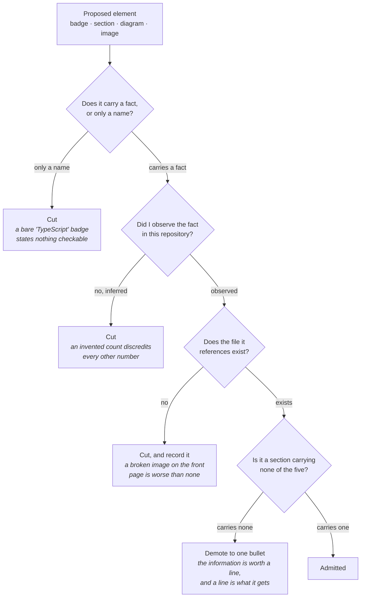

<div align="center">

# README Architect

**A Claude Code skill that writes your README after running your project — not after reading your
folder names. Every number in what it produces is one it observed, and anything it could not
observe it tells you it could not observe.**

Six reference files and one workflow, in plain Markdown.
**No dependencies, no build step, no runtime — nothing here executes.**


<a href="LICENSE"></a>


<a href="docs/SPEC.md">Spec</a> ·
<a href="docs/CONSTITUTION.md">Constitution</a> ·
<a href="SKILL.md">Skill</a>

</div>

---

## Why most generated READMEs are adjectives

Ask a model for a README and it reads the directory, infers what the project probably does, and
writes *"robust error handling"*, *"clean architecture"*, *"blazing fast"*. Every one of those is
unfalsifiable, which is another way of saying it carries no information. The reader learns nothing
and — worse — learns that this README is the kind that carries nothing.

This skill's entire design follows from one rule:

> **Show it. Never describe what a reader could be shown.**

*"Handles concurrent requests safely"* is an assertion. *"Two arrivals reach the runway exactly one
tick apart (07:11:51 → 07:11:56) — one at a time, enforced by the queue"* is evidence, and it comes
with the timestamps to check it. The first is free to write. The second requires running the thing.

So the workflow runs the thing. It reads the manifest, the entry point, the tests and
`.env.example`; it starts the project, hits an endpoint, runs the suite; and only then does it
write. Where it genuinely cannot run something — no credentials, no hardware, a paid service — it
says so to you and writes from the tests instead, carrying no timings and no screenshots, because
those would have to be invented.

## Nothing gets in because it would look right there

The failure mode of every README template is that it has slots, and slots get filled. A badge row
gets badges. A screenshot section gets a screenshot. The document ends up shaped like a good README
without being one.

So every element faces an admission test with a stated condition, and failing it means removal —
not padding until it looks sufficient.



The five a capability section may carry: **a diagram, a table, real program output, a measured
number, or an image.** Not a well-written paragraph, not a list of sub-features, not a claim that
the approach is unusual — those are the raw material of a section, not a section.

**This README is the worked example.** It has no CI badge and no test-count badge because this
repository has neither a pipeline nor a suite; it has no hero image because none was produced.
Five badges, all checkable. That is what the test produces when it is applied honestly, and it is
why there is no sixth reference file holding a fabricated sample.

## What it writes, and what it refuses to

| Writes | When |
|---|---|
| `README.md` | Always |
| `docs/SETUP.md` | Setup needs more than the commands that fit in Run it |
| `docs/ARCHITECTURE.md` | The mechanism needs more room than one section |
| `docs/brand/*.svg` | A typographic wordmark, light and dark — never a pictorial mark |
| `docs/assets/screens/*.png` | Capture succeeded |
| `docs/SCREENSHOTS.md` | Capture failed, was impossible, or you declined |

That list is the whole write surface. It creates no `CONTRIBUTING.md`, no `CHANGELOG.md`, no
`ROADMAP.md` unless you ask by name — a visitor did not open your repository for its process, and
an empty process file reads as a template somebody forgot to finish.

> [!IMPORTANT]
> **It never runs a git command that writes.** No commit, no push, no tag. It produces files;
> whether they enter your history is a decision you make after reading them. It also redacts any
> secret, token or personal name found in real output before writing it, and marks the
> redaction — because an unmarked redaction is a fabricated line.

## Screenshots are asked about, never guessed

Whether your project is a page at a URL, a desktop window, or a terminal session — and whether it
needs credentials or staging into a particular state — are facts you have and the skill does not.
So it asks, offering the mechanisms that fit what it found, plus a custom option where you write
the instruction yourself.

When capture fails or you decline, it writes `docs/SCREENSHOTS.md`: for each shot, the filename,
what must be visible, how to stage it, and where it goes in the README. Then it tells you plainly
that this was the one thing it could not do. **It never references an image it did not produce.**

## Run it

There is nothing to run. It is Markdown that Claude Code reads.

```bash
# as a plugin
/plugin marketplace add DahanItamar/readme-architect
/plugin install readme-architect

# or drop it in directly
git clone https://github.com/DahanItamar/readme-architect \
          ~/.claude/skills/readme-architect
```

Then ask for a README in whatever words you would have used anyway — *"write a README for this"*,
*"my README is out of date"*, *"make this presentable before I make it public"*. Both install
routes work because `SKILL.md` sits at the repository root and every path it names is relative to
itself.

## Under the hood — briefly

- **Progressive disclosure.** `SKILL.md` is 245 lines and loads every invocation; the six
  reference files are 1,096 lines and load only at the phase that needs them. A reference file is
  read cold and alone, so each is complete by itself and none links to another.
- **Built by its own pipeline.** `docs/SPEC.md` carries 44 acceptance criteria in EARS notation,
  and every one is closed by a task in `docs/changes/`. The constitution, spec, task lists and
  change proposals are all committed — the reasoning is the asset, not just the result.
- **Badges are tested, not banned.** v1 forbade badge rows outright. That ban was a proxy for
  *badges usually carry nothing*, and the proxy failed on `runtime deps 1`, which carries the most
  interesting fact about a project. So the rule now tests the badge, not the row.
- **Mermaid ahead of any image format.** It renders on GitHub, it is plain text in the diff, it
  needs no file to rot, and where it does not render it degrades to readable source rather than to
  a broken image.
- **Nothing executes.** No dependencies, no build, no scripts. Installation is a file copy, and a
  repository that only contains Markdown is one you can actually audit before running it.

> Also here: [`docs/CONSTITUTION.md`](docs/CONSTITUTION.md), the rules this repository holds itself
> to, and [`docs/SPEC.md`](docs/SPEC.md), which records why each decision beat its alternative.
> Read those before changing anything — they separate what was decided from what was merely typed.

---

<div align="center">

Built by <a href="https://github.com/DahanItamar">Itamar Dahan</a> · <a href="LICENSE">MIT</a> · © 2026

</div>
