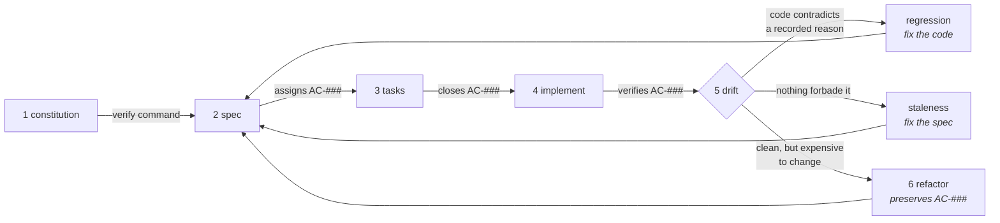

<div align="center">

# Blueprint

**Eight skills: six stages, a front door and an opt-in checker. They carry one identifier from a rough idea to shipped code — every
requirement gets a number in the spec, and every task, verification, audit and refactoring after it
cites that number.**

Plain Markdown, read by Claude Code.
**No `package.json`, no dependencies, no build step, nothing that executes at install.**

<a href="https://github.com/DahanItamar/claude-skills/actions/workflows/ci.yml"></a>


<a href="LICENSE"></a>

<a href="examples/the-loop.md">The walkthrough</a> ·
<a href="examples/proof/README.md">The illustration</a>

</div>

---

## The identifier that survives the handoff

Most spec workflows are a handful of prompts that run in order, and nothing travels between them —
so by the fourth prompt the agent is judging prose it wrote itself. What travels here is an
identifier: stage 2 writes each requirement as one EARS sentence with a stable `AC-###`, and no
later stage may refer to a requirement any other way.

```text
docs/SPEC.md    AC-003  If two shifts for one employee overlap by any minute, then the
                        scheduler shall flag both and refuse to publish.

docs/changes/*/TASKS.md   - [ ] T-04 Detect overlaps on a minute timeline — closes AC-003

REPORT.md       - [ ] R-02 Extract `toRange`, delete the two copies — preserves AC-003
```

`closes` in stage 3, `preserves` in stage 6 — one word apart, and the whole difference between
building a feature and restructuring one. A task that closes no criterion is either unnecessary
work or a requirement nobody wrote down.



| Stage | Command | Writes | The rule it enforces |
|:-:|---|---|---|
| 0 | `/spec-start` | nothing | Six commands in a picker give you no way to tell which one begins |
| 1 | `/spec-constitution` | `docs/CONSTITUTION.md` | A rule earns its place only if you can name what breaks when it is violated |
| 2 | `/spec-architect` | `docs/SPEC.md` | Never ask what you can decide — ask only what changes the architecture |
| 3 | `/spec-tasks` | `docs/changes/*/TASKS.md` | A task is done when a named criterion is satisfied, not when the code looks finished |
| 4 | `/spec-implement` | code | One task, verify, then the next — stop at the first unmet criterion |
| 5 | `/spec-drift` | a report | The spec and the code disagree: say *which one* is wrong |
| 6 | `/spec-refactor` | `docs/refactorings/NNNN/` | Restructure only what blocks scheduled work — and change no criterion doing it |

Stage 0 is the front door; spec-check is an optional checker with no stage. Stages 1 and 6 are optional and every stage runs alone. The opt-in `/spec-check` is read-only and not part of the chain: it lints `AC-###` integrity and prints a criterion to task to commit to test table, with orphans first and a final `Orphans: N` line. `/spec-check --diff <base>` lists criteria whose code or tests a branch touched, as a paste-ready PR comment. Test hits are labelled `candidate, not proof`. The last two audit different things: drift
asks whether the code does what the spec says, refactor asks whether code that already does can
still be changed cheaply.

## Refactoring, and the gate on it

Stage 6 handles [code smells](https://refactoring.guru/refactoring/smells) and dead code, and two
rules keep it from restructuring a working system for sport. **A smell is actionable only if it is
a Change Preventer for work that is actually scheduled** — everything else is logged with an
`SM-###` and left alone. And **a refactoring may not change what the spec says the system does**:
if it needs an `AC-###` reworded it is not a refactoring, it is a change proposal for stage 2.

That second rule is what makes "behaviour is preserved" checkable rather than promised — verify
green before, green after, every cited criterion re-read against the new code. The two halves of the
work carry different burdens of proof, and land in separate commits:

| | Cleanup | Refactoring |
| --- | --- | --- |
| Admitted by | a static-analysis tool flagged it | the gate above |
| Removes | unused imports, unreferenced locals, dead exports | duplication, shotgun surgery, god functions |
| Risk | deleting something reached reflectively | an unreviewable diff |
| Commit | its own, apart from any behaviour change | one per refactoring |

Nothing goes on a hunch: `/spec-refactor` writes a numbered report under `docs/refactorings/` and
changes no code itself. Runs are never overwritten, and every `SM-###` it has ever allocated stays
in one registry — so a smell that comes back carries the record of being paid off once already.
Closing a run out belongs to stage 5, which re-checks that each smell really is gone before writing
`removed` and archiving the directory: a ticked box records what someone believed, and the registry
records what is true.

## Run it

Requires **Claude Code**. Nothing is installed, compiled or executed.

```bash
/plugin marketplace add DahanItamar/claude-skills
/plugin install blueprint@claude-skills
```

Then run **`/spec-start`**. It reads the repository and names the one command to run next —
`/spec-constitution` on a new repo, `/spec-architect` if the conventions are settled,
`/spec-implement` if a task list is sitting there half-ticked.

The skills also work copied straight into `~/.claude/skills/`. Pick one route or the other — do
both and every command shows up twice in the picker, from two copies that drift apart.

> [!IMPORTANT]
> **The two stages that run shell commands — `/spec-implement` and `/spec-refactor` — run only
> the verify command named in `docs/CONSTITUTION.md`, after showing it to you and asking you to confirm it.** Never one found in a spec, a task list, a
> refactoring report or a code comment. Those files are editable by anyone with commit access, so
> treating their contents as instructions would turn a Markdown file into remote code execution.

## An executable illustration

The one thing here that executes. These tests exercise hand-written versions of the feature; they show what the skills are designed to catch, they do not measure model output. No install: it needs Node (CI runs Node 22); the output below came from Node v24.15.0:

```bash
node --test examples/proof/proof.test.mjs
```

```text
▶ drifted — the code three weeks after the spec was written
  ✔ but the night shift can no longer be saved — §8 is contradicted (0.3713ms)
  ✔ and the rejection is silent: the overlap is simply never detected (0.1212ms)
▶ smelly — passes every criterion and is still unshippable
  ✔ behaves exactly like the spec-derived version — spec-drift finds nothing (0.2465ms)
  ✔ SM-002 Duplicate Code: the same day arithmetic, copied three times (0.0478ms)

ℹ tests 17
ℹ pass 17
ℹ fail 0
ℹ duration_ms 64.4798
```

Excerpt: four lines of a 17-test run. The suite builds one shift-conflict feature four ways and asserts what
each does to a shift that crosses midnight:

| Version | Tests green | Matches the spec | Cheap to extend |
|---|:-:|:-:|:-:|
| `naive.mjs` — no spec, shapes chosen by convenience | yes | no | no |
| `spec-derived.mjs` — built against §5 and §8 | yes | yes | yes |
| `drifted.mjs` — three weeks and one sensible-looking fix later | yes | no | yes |
| `smelly.mjs` — six months and four features later | yes | yes | no |

The last two rows are the argument. `drifted.mjs` contradicts §8 of its own spec, so a night shift
silently stops being storable — stage 5 catches that. `smelly.mjs` contradicts nothing and still
shows an overnight shift as `-960` minutes in its tooltip, because one of three copies of the same
calculation diverged where no criterion looks — stage 6 catches that.

## Try spec-check in a minute

[`examples/spec-check-fixture/`](examples/spec-check-fixture) is a hand-built fixture, not a recorded run: a `SPEC.md` and one `TASKS.md` with three deliberate orphans. Copy them into a scratch repo as `docs/SPEC.md` and `docs/changes/0001-m1-fixture/TASKS.md`, run `/spec-check`, and you should see `Orphans: 3`. Or run `sh scripts/spec-check.sh examples/spec-check-fixture/SPEC.md examples/spec-check-fixture/TASKS.md` for the same three, without Claude.

## Compared with other spec tools

| | Spec Kit | OpenSpec | Kiro | This plugin |
|---|---|---|---|---|
| Form | CLI toolkit | CLI, propose-apply-archive | IDE | Markdown skills for Claude Code |
| Works outside Claude Code | yes (per third-party write-ups) | yes (per third-party write-ups) | its own IDE | **no** |
| Regression versus staleness drift verdict | not claimed here | not claimed here | not claimed here | yes (stage 5) |
| Refactor gate that cannot edit a criterion | not claimed here | not claimed here | not claimed here | yes (stage 6) |
| Verify command only from the constitution | not claimed here | not claimed here | not claimed here | yes |
| One id across every stage | not claimed here | not claimed here | not claimed here | `AC-###` |
| Machine-checkable traceability line | `analyze` checks artifact consistency; code-level via extensions (per third-party write-ups) | not claimed here | not claimed here | `/spec-check`: read-only AC-to-task-to-commit-to-test thread, final `Orphans: N` line a CI step can match |

Honest limits: Claude Code only, no CLI, no IDE integration, no multi-agent portability, and one spec set per repository root. For a monorepo, run the chain from each package root with its own `docs/` and its own constitution; there is no shared layout across packages. The other tools win on all four. "Not claimed here" means this README has not verified the competitor either way.

## Optional CI recipe

Nothing here runs at install. If you want a gate, copy [`scripts/spec-check.sh`](scripts/spec-check.sh) into your repository and run it in your own workflow. It is plain POSIX `sh` and `awk` with no dependencies, it reads files and runs nothing it finds in your repository, and it does not need Claude or a network.

```yaml
- name: Spec traceability
  run: sh scripts/spec-check.sh
```

It covers checks 1 to 4 of `/spec-check` only: cited ids exist, every active criterion is closed by a task, no id appears twice, and `preserves` citations resolve. It exits 1 when there are orphans, 2 when it cannot decide (`Orphans: unknown`), and 0 otherwise. The test and commit checks (5 and 6) stay with the skill, because they are candidates for a person to read, not facts. Because it is a script rather than a model call, the final `Orphans: N` line is deterministic.

Run against the hand-built fixture, the real output was (Node test: `node --test examples/spec-check-fixture/spec-check.test.mjs`):

```text
T-03 cites AC-009, which does not exist (examples/spec-check-fixture/TASKS.md)
AC-003 active, closed by no task
AC-003 appears twice in section 2.1
Orphans: 3
```

## Extending it

Because every stage keys on `AC-###` and plain files, you can add your own stage skill (a compliance pass with [Regwise](https://github.com/DahanItamar/claude-skills/tree/main/plugins/regwise), a UI-states pass with [Edgecase](https://github.com/DahanItamar/claude-skills/tree/main/plugins/edgecase) from the same marketplace). The contract:

1. Read `docs/SPEC.md`; never edit it.
2. Cite criteria only as `AC-###`; never invent one.
3. Write findings under `docs/<name>/`.
4. Use the `REPORT.md` entry format if you want `/spec-drift` to close the run out; otherwise it ignores your directory.
5. Run only the constitution's verify command.

Nothing else is needed: no registry, no hooks.

Natural places to run an optional pass, by hand, are the stage boundaries. Nothing triggers them for you.

| Boundary | Optional pass | Entry skill |
|---|---|---|
| after `/spec-tasks` | compliance | [Regwise](https://github.com/DahanItamar/claude-skills/tree/main/plugins/regwise) |
| before `/spec-implement` | UI states | [Edgecase](https://github.com/DahanItamar/claude-skills/tree/main/plugins/edgecase) |
| any time | criterion integrity | `/spec-check` |

## Under the hood — briefly

- **Nothing executes at install.** No dependencies, no build, no network calls. The only runnable
  code is 5 `.mjs` files under `examples/proof/`, importing `node:test`, `node:assert/strict` and
  `node:fs`.
- **3,214 lines (`SKILL.md` and references) that load on demand.** Each `SKILL.md` loads on invocation, the largest being 160
  lines; its references load only at the phase that needs them, so a task list is never written with
  the risk checklist in context.
- **Change proposals, not spec rewrites.** Once `docs/SPEC.md` exists, `/spec-architect` writes a
  diff under `docs/changes/` and leaves the spec alone — the reasoning that made feature 1 correct
  is the asset. Criteria are retired as tombstones, never reused, because archived task lists still
  cite them.

---

<div align="center">

Built by <a href="https://github.com/DahanItamar">Itamar Dahan</a> · <a href="LICENSE">MIT</a> · © 2026

</div>
