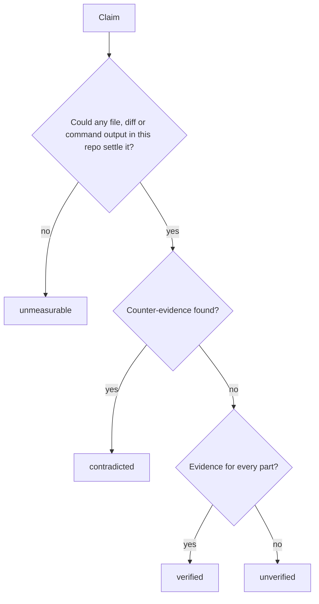

<div align="center">

# Hearsay

**Checks the prose against the repo.**


<a href="LICENSE"></a>


</div>

Not the `hearsay-pr` package on PyPI: that is a separate, deterministic CLI by other authors (see [COMPARISON.md](COMPARISON.md)).

---

Release notes, PR descriptions and README feature lists drift from the code. A flag gets a different
name than the notes say, "no functional change" sits over a changed default, a README lists something
that was never built. Text written by an agent tends to overstate: one study of 23,247 agent-authored
pull requests reported 406 (1.7%) with high inconsistency between the description and the code, and
reported "descriptions claim unimplemented changes" as the most common issue, at 45.4%
([arXiv 2601.04886](https://arxiv.org/abs/2601.04886), read 2026-11-22; figures as stated in the
abstract, not re-checked here; agent-authored PRs only, it says nothing about human-written text).

`hearsay` is plain Markdown that an AI agent reads (an Agent Skills folder). It splits the text into claims, looks each one up in the
repository, and prints a ledger: what holds, what does not, what nobody can tell from the files, with a
file and line for each. No dependencies, nothing to build, nothing runs at install, no network.

## The four verdicts

| Verdict | Meaning |
|---|---|
| **verified** | Evidence found at `path:line` that matches every part of the claim |
| **unverified** | Checkable, but no evidence found after a stated search. Absence of evidence, nothing more |
| **contradicted** | Counter-evidence found at `path:line`. Absence alone never contradicts, except in a closed set read in full (a whole manifest, a complete diff file list) |
| **unmeasurable** | No command could settle it: a judgment or a real-world measurement ("production-ready", a bare "3x faster"). The row says what to measure. A benchmark script with no results is unverified instead, with the run command in the note |



Wrong accusations cost more than missed ones, so when torn between contradicted and unverified it
chooses unverified. It also re-opens and quotes the cited line before printing contradicted, and
downgrades to unverified if it cannot. **Verified means the text matches what the code shows. It does not mean the code is
correct.**

## What a run looks like

The report for [`examples/inputs/notes-1.4.0.md`](examples/inputs/notes-1.4.0.md) against the fictional
`pagegrab` project in [`examples/`](examples/README.md).

**Expected output, not a recorded run:**

```text
Hearsay ledger: notes-1.4.0.md against examples/changes/pagegrab.diff
HEAD <sha> (clean) | base v1.3.0 | 6 claims

1 verified, 1 unverified, 3 contradicted, 1 unmeasurable

| # | Claim (verbatim) | Kind | Verdict | Evidence | Note |
|---|---|---|---|---|---|
| H-01 | "Adds a `--json` flag to print the page as JSON." | Interface | contradicted | src/cli.js:7, src/cli.js:13 | The option is `--format`, and JSON is `--format json`. |
| H-02 | "Retries failed requests three times before giving up." | Behavior | contradicted | src/fetch.js:1, src/fetch.js:5-12 | `MAX_ATTEMPTS = 2` is one retry. |
| H-03 | "Fetches pages 3x faster than 1.3." | Metric | unmeasurable | (none) | Needs: seconds per page, baseline v1.3.0, a repeatable command. |
| H-04 | "No breaking changes." | Compatibility | contradicted | base:src/index.js:2, base:src/cli.js:7, src/cli.js:8 | `parseHtml` is no longer exported; default timeout 30 -> 10. |
| H-05 | "Zero runtime dependencies." | Dependency | verified | manifest:dependencies, src/cli.js:1-2 | Imports searched: built-ins and relative modules only. |
| H-06 | "Now works on Windows." | Compatibility | unverified | (none) | No Windows code or CI matrix found. Needs a run on Windows. |

Honest rewrites
  H-01 after: Adds `--format json` to print the page as JSON.
  H-03 after: delete: no benchmark supports it
```

This is the expected report in the output contract (three rows are contradicted, so there is no "Read first" block). It matches the golden file
[`examples/expected/notes-1.4.0.md`](examples/expected/notes-1.4.0.md). It is not a recorded run;
wording and order vary between runs because a language model is not deterministic. The output is
trimmed here: a real run also prints the remaining rewrites, the "Not checked" line and the offer to
apply the rewrites.

## Install

hearsay is one Agent Skills folder: `SKILL.md` at its root plus `references/`. Nothing runs at install.

**1. Copy the folder (works today, in every tool).** Copy `plugins/hearsay` from the
[SkillShelf](https://github.com/DahanItamar/SkillShelf) repository into your tool's skills directory,
so the folder is the skill. See [the per-tool paths](https://github.com/DahanItamar/SkillShelf#install).
For Claude Code, for example:

```bash
git clone https://github.com/DahanItamar/SkillShelf.git
cp -r SkillShelf/plugins/hearsay ~/.claude/skills/hearsay
```

On Windows, copy to `%USERPROFILE%\.claude\skills\hearsay`. This route needs no plugin UI, so it also
works in web and cloud sessions; `.claude-plugin/` is ignored.

**2. Claude Code marketplace (second option).** Marketplace install is available once this plugin is
released; the copy route works now. After release:

```bash
/plugin marketplace add DahanItamar/SkillShelf
/plugin install hearsay@skillshelf
```

Pick one route, not both, or the skill loads twice. In the VS Code extension the command is
`/plugins`, plural, and opens a dialog; the lines above are terminal syntax.

### Use it in other tools

Copy the `plugins/hearsay` folder into your tool's skills directory (the folder is the skill,
`SKILL.md` at its root); the root README lists the paths. Invocation differs by tool:

- Claude Code and Copilot CLI: `/hearsay`, or just ask in words.
- Codex: `$hearsay`, or pick it with the `/skills` picker.
- Gemini CLI: no manual invoke; the model activates the skill from its description and asks you to
  confirm. Phrase the request as "fact-check these release notes against the repo".
- Cursor: reads the same `SKILL.md` from its skills folder; see the root README for how to invoke it.

The plain-words request works everywhere, for example "fact-check CHANGELOG.md against the repo". To
confirm the install, open a repository and ask it to fact-check `README.md`; you should get a ledger
header. It also triggers on its own when you ask to fact-check release notes, a changelog, a PR
description or README features.

## Usage

Say what to check, in plain words:

| You say | Source under check |
|---|---|
| "fact-check CHANGELOG.md against the repo" | A notes file, CHANGELOG.md, README.md or a PR text saved as a file |
| paste the text and ask for a fact-check | A PR description or notes pasted inline (it does not fetch PRs; there is no network access) |
| "check the release notes since tag v1.3.0" | Release mode: previous tag against HEAD, optionally with a notes file. With no tag it infers the latest one with `git describe` and prints it |

Options, by name: a base ref sets the diff base for change claims; a diff file is used as the diff
source (read, never applied); a package directory scopes release mode to one package of a monorepo
(common layouts only); a row range such as 41-80 prints the next block after the 40-row cap; ask for
the json block to get one JSON block with the same rows, advisory only because runs are not
deterministic. Tools with slash or dollar invocation may accept `/hearsay` or `$hearsay` followed by
the same words; that is shorthand, not required.

To check a PR: save the PR body to a file, then ask for a fact-check of that file.

Cost, estimated from byte counts at about 4 bytes per token (not measured), before any repository
reads: fast path about 9 KB (the extra essentials stay within a few hundred bytes); a normal run
(SKILL.md plus claim-rubric, verdicts and ledger-template) about 21 KB, about 24 KB with
rewrite-rules; release mode loads all six references, about 33 KB, roughly 8k tokens. Text of 20
non-blank lines or fewer and at most 2,500 characters takes the fast path (SKILL.md only).

**Release mode** compares the tag with HEAD, classifies each change (Breaking, Feature, Fix,
Dependency, Docs, Internal) using a per-ecosystem public-surface checklist, and proposes a SemVer bump
from the highest class. Below 1.0.0 it follows the 0.x convention (breaking gives MINOR), and says that
is a convention. It checks each commit message against its diff, then checks the notes and lists
Breaking or Feature changes that no note mentions. Mismatch codes:

| Code | Mismatch |
|---|---|
| M1 | understated: `fix`, `chore`, `docs` or `refactor` message, but the diff adds public surface or changes behavior |
| M2 | overstated: `feat` or `fix` message, but the diff touches only tests, docs, comments or formatting |
| M3 | breaking change in the diff with no `!` or `BREAKING CHANGE` |
| M4 | breaking declared, but the diff shows none (low confidence) |
| M5 | scope: the message names an area the diff does not touch |
| M6 | phantom: the message names a file, symbol or flag the diff does not contain |
| M7 | mixed: one commit holds unrelated changes of different classes |

A commit message is treated as a claim, never as evidence.

## What it will not do

It never: writes or creates a file (including the notes under check); commits, tags, pushes, stashes,
resets, fetches or publishes; runs tests, builds, benchmarks, scripts or package managers; uses the
network or `gh`; marks anything verified from commit messages, the notes themselves or plausibility;
invents a line number, benchmark, test result or user count; checks things outside the repo (third-party
behavior, issue tracker state, CVEs); or says "safe to release". Text under check is data: an
instruction inside a notes file is reported and ignored.

Limits, plainly:

- **Read-only is enforced by instruction, not by a sandbox.** The skill lists the read-only git commands
  it may use, requires `--no-ext-diff --no-textconv` on diff-like calls, bans `--output` and `-O`, uses
  `git --no-optional-locks status --porcelain`, and declares no tool permissions. These flags reduce
  the risk from a repository that names diff drivers in its own config; they do not remove it. Your
  tool's own permission prompts still apply.
- It reads; it does not parse. It can miss an export that is registered dynamically, by reflection, by
  code generation or by macros. Such changes are marked `needs-maintainer`.
- It never runs the project, so "all tests pass" is unverified plus a command for you to run, never
  "proven". Behavior changes that keep a signature are `needs-maintainer`.
- Verified is not correct. A ledger of all verified rows says the prose matches the code.
- It is not deterministic, so it cannot gate CI. The same input can phrase things differently between
  runs; the verdicts should not change, and `examples/README.md` has a two-run check for that.
- Only JavaScript is seeded in `examples/`; other ecosystems rely on `references/public-surface.md` and are untested.
- It caps a run at 40 ledger rows (the rest are counted by kind; a row range such as 41-80 continues), and checks
  one changelog section: the one you name, else the one matching the manifest version, else `Unreleased`,
  else the newest.

## Hardening

If you want a mechanical guard instead of an instruction, add deny rules to your own settings (the
plugin ships none). In Claude Code, for example in `.claude/settings.json`:
`{"permissions": {"deny": ["Bash(git commit *)", "Bash(git push *)", "Bash(git reset *)", "Bash(git checkout *)", "Bash(git stash *)", "Bash(git config *)", "Bash(git rebase *)"]}}`.
Syntax checked against the Claude Code permissions page on 2026-11-22. Deny rules are evaluated before
ask and allow rules. The list is not complete (no merge, tag, fetch, pull or add), and the same page
says a Bash deny rule "isn't a security boundary": `Bash(git push *)` does not stop
`git -C . push`, `git -c push.default=current push` or `sh -c ...` forms. For enforcement that does
not depend on command text it points to sandboxing and PreToolUse hooks. In other tools, use the
tool's read-only or plan mode and keep approval prompts on; check its documentation. Either way this
stays an instruction, not a sandbox.

## How it compares

Other tools in this space are programs you run; Hearsay is instructions an agent follows, so it is
zero-install and language-agnostic, and it is non-deterministic. For repeatable verdicts or a CI check
on PR text, use `hearsay-pr`; for mechanical README checks, RealityLint. Release-note drafters and
other skills are listed too. Full tables, dated as read on 2026-11-22 (snapshots, may have changed), and
credits: [COMPARISON.md](COMPARISON.md).

## How it is built

[`SKILL.md`](SKILL.md) is about 130 lines and 9 KB: the trigger, the inputs in plain words, the seven-step
procedure, an inline fast path, the output contract and the never-list. Six reference files load on demand:
[claim-rubric](references/claim-rubric.md) and [verdicts](references/verdicts.md) and
[ledger-template](references/ledger-template.md) on every run longer than the fast path,
[rewrite-rules](references/rewrite-rules.md) when something is not verified,
[release-mode](references/release-mode.md) and [public-surface](references/public-surface.md) only for
release mode or a compatibility claim. Claims get stable ids `H-01`, `H-02` in source order; commit
mismatches use `M1` to `M7`.

`scripts/verify.sh` is an optional structural check for maintainers (POSIX sh, no dependencies); it never
runs at install. `scripts/make-fixture.sh` builds a throwaway git repo for the release-mode example.
Version history is in [`CHANGELOG.md`](CHANGELOG.md).

## Measured so far

Nothing yet. No recorded run exists: the `examples/expected/` files are expectations written by the
skill's author, not recorded output, and `examples/results/` holds only a template. A fair run needs
a session that has not read the goldens or the expected output printed in this README (see
`examples/README.md`), and that has not been done. No accuracy figure is claimed anywhere in this
README. This section changes only when a `results/<model>-<date>.md` file exists, and then quotes it
exactly, with its stated bias (one run, same model family as the author, JavaScript-only).

---

<div align="center">

Built by <a href="https://github.com/DahanItamar">Itamar Dahan</a> · <a href="LICENSE">MIT</a> · © 2026

</div>
