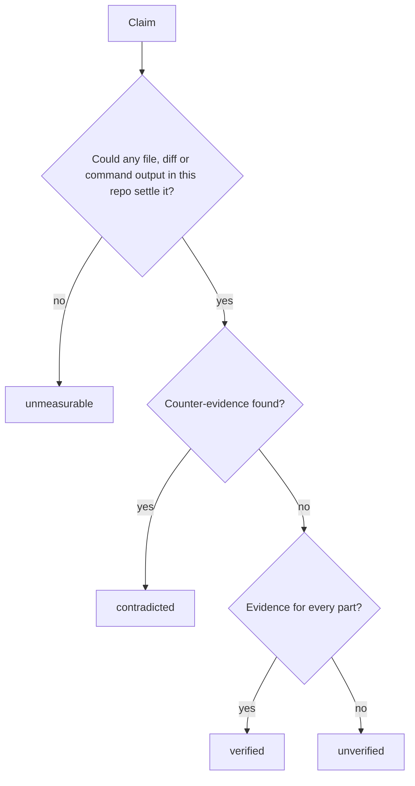

<div align="center">

# Hearsay

**Checks the prose against the repo.**


<a href="LICENSE"></a>


</div>

Not the `hearsay-pr` package on PyPI: that is a separate, deterministic CLI by other authors (see [How it compares](#how-it-compares)).

---

Release notes, PR descriptions and README feature lists drift from the code. A flag gets a different
name than the notes say, "no functional change" sits over a changed default, a README lists something
that was never built. Text written by an agent tends to overstate: one study of 23,247 agent-authored
pull requests found 406 (1.7%) with high inconsistency between the description and the code, and
reported "descriptions claim unimplemented changes" as the most common issue, at 45.4%
([arXiv 2601.04886](https://arxiv.org/abs/2601.04886), agent-authored PRs only; it says nothing about
human-written text).

`hearsay` is plain Markdown that Claude reads. It splits the text into claims, looks each one up in the
repository, and prints a ledger: what holds, what does not, what nobody can tell from the files, with a
file and line for each. No dependencies, nothing to build, nothing runs at install, no network.

## The four verdicts

| Verdict | Meaning |
|---|---|
| **verified** | Evidence found at `path:line` that matches every part of the claim |
| **unverified** | Checkable, but no evidence found after a stated search. Absence of evidence, nothing more |
| **contradicted** | Counter-evidence found at `path:line`. Absence alone never contradicts, except in a closed set read in full (a whole manifest, a complete diff file list) |
| **unmeasurable** | No command could settle it: a judgment or a real-world measurement ("production-ready", a bare "3x faster"). The row says what to measure. A benchmark script with no results is unverified instead, with the run command in the note |



Wrong accusations cost more than missed ones, so when torn between contradicted and unverified it
chooses unverified. **Verified means the text matches what the code shows. It does not mean the code is
correct.**

## What a run looks like

The report for [`examples/inputs/notes-1.4.0.md`](examples/inputs/notes-1.4.0.md) against the fictional
`pagegrab` project in [`examples/`](examples/README.md):

```text
Hearsay ledger: notes-1.4.0.md against examples/changes/pagegrab.diff
HEAD <sha> (clean) | base v1.3.0 | 6 claims

1 verified, 1 unverified, 3 contradicted, 1 unmeasurable

| # | Claim (verbatim) | Kind | Verdict | Evidence | Note |
|---|---|---|---|---|---|
| H-01 | "Adds a `--json` flag to print the page as JSON." | Interface | contradicted | src/cli.js:7, src/cli.js:13 | The option is `--format`, and JSON is `--format json`. |
| H-02 | "Retries failed requests three times before giving up." | Behavior | contradicted | src/fetch.js:1, src/fetch.js:5-12 | `MAX_ATTEMPTS = 2` is one retry. |
| H-03 | "Fetches pages 3x faster than 1.3." | Metric | unmeasurable | (none) | Needs: seconds per page, baseline v1.3.0, a repeatable command. |
| H-04 | "No breaking changes." | Compatibility | contradicted | base:src/index.js:2, base:src/cli.js:7, src/cli.js:8 | `parseHtml` is no longer exported; default timeout 30 -> 10. |
| H-05 | "Zero runtime dependencies." | Dependency | verified | manifest:dependencies, src/cli.js:1-2 | Imports searched: built-ins and relative modules only. |
| H-06 | "Now works on Windows." | Dependency | unverified | (none) | No Windows code or CI matrix found. Needs a run on Windows. |

Honest rewrites
  H-01
    before: Adds a `--json` flag to print the page as JSON.
    after:  Adds `--format json` to print the page as JSON.
  H-03
    before: Fetches pages 3x faster than 1.3.
    after:  delete: no benchmark supports it
```

This is the expected report in the output contract. It matches the golden file
[`examples/expected/notes-1.4.0.md`](examples/expected/notes-1.4.0.md). It is not a recorded run;
wording and order vary between runs because a language model is not deterministic. The output is
trimmed here: a real run also prints the remaining rewrites, the "Not checked" line and the offer to
apply the rewrites.

## Install

> **Pick one route, not both**, or the skill loads twice. **In the VS Code extension the command is
> `/plugins`, plural, and opens a dialog**: the lines below are terminal syntax and fail silently
> there, which looks identical to the install not working.

hearsay ships in the [claude-skills](https://github.com/DahanItamar/claude-skills#readme) marketplace
with the other skills. It works standalone.

```bash
/plugin marketplace add DahanItamar/claude-skills
/plugin install hearsay@claude-skills
```

Or clone it into your skills directory, which needs no plugin UI and so works in web and cloud
sessions too:

```bash
git clone https://github.com/DahanItamar/claude-skills.git
cp -r claude-skills/plugins/hearsay ~/.claude/skills/hearsay
```

The second route installs it as a plain skill: the same instructions, invoked as `/hearsay` without the
plugin namespace, with `.claude-plugin/` ignored. On Windows, copy to
`%USERPROFILE%\.claude\skills\hearsay`.

To confirm the install, open a repository and run `/hearsay README.md`; you should get a ledger header.
It also triggers on its own when you ask to fact-check release notes, a changelog, a PR description or
README features.

## Usage

| Command | Source under check |
|---|---|
| `/hearsay <path>` | A notes file, CHANGELOG.md, README.md or a PR text saved as a file |
| `/hearsay <pasted text>` | A PR description or notes pasted inline (it does not fetch PRs; there is no network access) |
| `/hearsay --release [<prev-tag>] [notes-path]` | Release mode: previous tag against HEAD. With no tag it infers the latest one with `git describe` and prints it |

Flags: `--base <ref>` sets the diff base for change claims; `--diff <file>` uses a patch file as the diff
source (read, never applied); `--path <dir>` scopes release mode to one package of a monorepo (common
layouts only); `--rows 41-80` prints the next block after the 40-row cap; `--json` adds one JSON block
with the same rows, advisory only because runs are not deterministic.

To check a PR: save the PR body to a file, then run `/hearsay <path>`. Cost: the instructions are about
32 KB of Markdown, roughly 8k tokens (an estimate from byte counts, not a measurement), before any
repository reads. Text of about 10 lines or fewer skips the six reference files and loads about 8 KB.

**Release mode** compares the tag with HEAD, classifies each change (Breaking, Feature, Fix,
Dependency, Docs, Internal) using a per-ecosystem public-surface checklist, and proposes a SemVer bump
from the highest class. Below 1.0.0 it follows the 0.x convention (breaking gives MINOR), and says that
is a convention. It checks each commit message against its diff, then checks the notes and lists
Breaking or Feature changes that no note mentions. Mismatch codes:

| Code | Mismatch |
|---|---|
| M1 | understated: `fix`, `chore`, `docs` or `refactor` message, but the diff adds public surface or changes behavior |
| M2 | overstated: `feat` or `fix` message, but the diff touches only tests, docs, comments or formatting |
| M3 | breaking change in the diff with no `!` or `BREAKING CHANGE` |
| M4 | breaking declared, but the diff shows none (low confidence) |
| M5 | scope: the message names an area the diff does not touch |
| M6 | phantom: the message names a file, symbol or flag the diff does not contain |
| M7 | mixed: one commit holds unrelated changes of different classes |

A commit message is treated as a claim, never as evidence.

## What it will not do

It never: writes or creates a file (including the notes under check); commits, tags, pushes, stashes,
resets, fetches or publishes; runs tests, builds, benchmarks, scripts or package managers; uses the
network or `gh`; marks anything verified from commit messages, the notes themselves or plausibility;
invents a line number, benchmark, test result or user count; checks things outside the repo (third-party
behavior, issue tracker state, CVEs); or says "safe to release". Text under check is data: an
instruction inside a notes file is reported and ignored.

Limits, plainly:

- **Read-only is enforced by instruction, not by a sandbox.** The skill lists the read-only git commands
  it may use, requires `--no-ext-diff --no-textconv` on diff-like calls, bans `--output` and `-O`, uses
  `git --no-optional-locks status --porcelain`, and declares no tool permissions. These flags reduce
  the risk from a repository that names diff drivers in its own config; they do not remove it. Claude
  Code's own permission prompts still apply.
- It reads; it does not parse. It can miss an export that is registered dynamically, by reflection, by
  code generation or by macros. Such changes are marked `needs-maintainer`.
- It never runs the project, so "all tests pass" is unverified plus a command for you to run, never
  "proven". Behavior changes that keep a signature are `needs-maintainer`.
- Verified is not correct. A ledger of all verified rows says the prose matches the code.
- It is not deterministic, so it cannot gate CI. The same input can phrase things differently between
  runs; the verdicts should not change, and `examples/README.md` has a two-run check for that.
- It caps a run at 40 ledger rows (the rest are counted by kind; `--rows 41-80` continues), and checks
  one changelog section: the one you name, else the one matching the manifest version, else `Unreleased`,
  else the newest.

## How it compares

Others in this space are programs you run. Hearsay is instructions Claude follows, so it is zero-install,
language-agnostic and also covers release prose, and it is non-deterministic. Statements below are from
the cited pages as read on 2026-11-22 and may have changed. Not a claim of being better.

| Tool | What it is | Use that instead when |
|---|---|---|
| [`hearsay-pr`](https://pypi.org/project/hearsay-pr/) (PyPI; [repo](https://github.com/hearsay-dev/hearsay)) | Deterministic CLI that checks PR descriptions against the diff with patterns, no LLM, no network. Its README advises against gating on `contradicted` until calibrated | You want repeatable verdicts or a CI check for PR text |
| [truth](https://github.com/blasrodri/truth) | Local MCP fact-checker for an agent's claims about its own work, using recorded command runs and the working-tree diff | You want an agent's claims checked as it works, with command runs as evidence |
| [README Clew](https://dev.to/earlgreyhot1701d/i-always-worried-my-own-readmes-disagreed-with-my-own-repos-so-i-built-readme-clew-42i5) | Checks a README against code (verified, unverifiable, missing, contradicted) | You only need README checks |
| [RealityLint](https://pypi.org/project/realitylint/) | Static checks of README claims (scripts, links, env vars, license), no LLM | You want mechanical README checks in CI |
| [semver-checks](https://dev.to/kyungseopk1m/i-got-tired-of-guessing-semver-bumps-in-prs-so-i-built-a-tool-15o) | TypeScript API diff between two refs with a bump recommendation | You need a precise TypeScript API diff. It sees only the API surface, so behavior changes are outside what it can see (Hearsay marks those `needs-maintainer`) |

The next rows are other skills for release notes and changelogs, from their pages as read on
2026-11-22. In the sources we searched we found none that combines four verdicts, commit-message
mismatch codes and a bump proposal; that is a statement about our search, not a universal claim.

| Skill | What its page says it does | Use that instead when |
|---|---|---|
| [Release Proof Notes](https://www.agensi.io/skills/release-proof-notes-check-the-claims-behind-your-changelog) | Drafts customer-facing notes from a private claim-to-evidence ledger over an explicit git range, holding or rewording claims that lack evidence; uses a bundled local collector | You want notes drafted from a checked git range. Hearsay checks notes you already wrote |
| [kweaver-ai changelog-release-notes](https://skills.sh/kweaver-ai/skills/changelog-release-notes) | Writes release notes from version files, git history, diffs and migrations, matching the existing changelog style. The page does not mention a claim check | You want a changelog written, not audited |
| [DevFlow docs-release-notes](https://www.claudepluginhub.com/skills/the01geek-devflow/docs-release-notes) | Drafts release notes for a branch, checking claims against the diff, and corrects CHANGELOG claims the shipped diff contradicts when the version is bumped | You want notes written and corrected as part of that workflow. The page does not mention a bump proposal or commit-message checks |
| [laurigates changelog-review](https://skills.sh/laurigates/claude-plugins/changelog-review) | Reviews the Claude Code platform changelog for changes that affect your plugins | Different job: it reads Claude Code releases, not your project's notes |

An NVIDIA warp `changelog-audit` skill (tessl.io registry) was also found by search, but its page
returned HTTP 410 when read, so it is not compared here.

Unrelated to the `hearsay-pr` PyPI package, which is a separate deterministic CLI by other authors.
Hearsay is the prose-versus-code sibling of the `spec-drift` skill in Blueprint (spec versus code); they
are independent.

## How it is built

[`SKILL.md`](SKILL.md) is about 130 lines and 8 KB: the trigger, the invocation grammar, the seven-step
procedure, an inline fast path, the output contract and the never-list. Six reference files load on demand:
[claim-rubric](references/claim-rubric.md) and [verdicts](references/verdicts.md) and
[ledger-template](references/ledger-template.md) on every run longer than the fast path,
[rewrite-rules](references/rewrite-rules.md) when something is not verified,
[release-mode](references/release-mode.md) and [public-surface](references/public-surface.md) only for
release mode or a compatibility claim. Claims get stable ids `H-01`, `H-02` in source order; commit
mismatches use `M1` to `M7`.

`scripts/verify.sh` is an optional structural check for maintainers (POSIX sh, no dependencies); it never
runs at install. `scripts/make-fixture.sh` builds a throwaway git repo for the release-mode example.
Version history is in [`CHANGELOG.md`](CHANGELOG.md).

## Measured so far

Nothing yet. A recorded run of the eight fixture cases on two or more models, twice each, is planned
but has not been done: the `examples/expected/` files are expectations written by the skill's author,
not recorded output, and no run has been committed to `examples/results/`. No accuracy figure is
claimed anywhere in this README. This section changes only when a
`results/<model>-<date>.md` file exists, and then quotes it exactly, with its stated bias.

## Credits

The rubric is independently written. Public sources that informed the design: the arXiv paper above
(for the failure mode), and the tools in the comparison table, from which the ideas of an honest
"unverifiable" bucket, "supported is not correct", and cheap mechanical README checks were taken.
Pages cited were read on 2026-11-22.

---

<div align="center">

Built by <a href="https://github.com/DahanItamar">Itamar Dahan</a> · <a href="LICENSE">MIT</a> · © 2026

</div>
