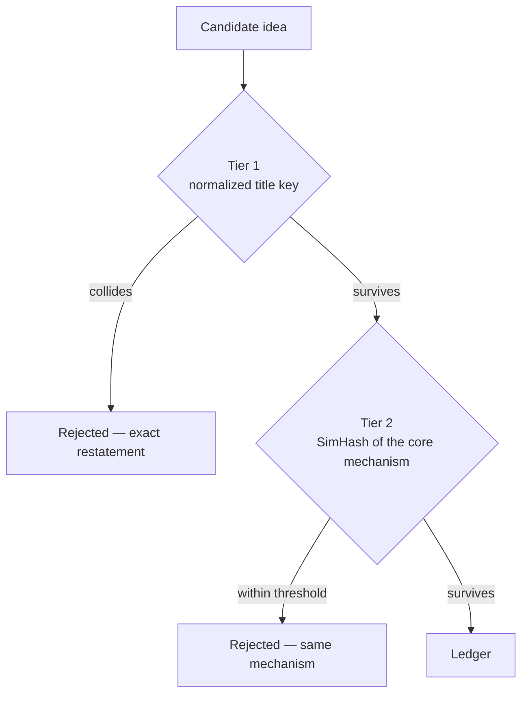

# Visuals

Diagrams, screenshots, and the wordmark. Three media, one rule between them: **a visual is
authored from something real, or it is not authored.**

**Scope.** This file covers producing the images and diagrams. Where they sit in the header block,
and the sections they fill, are specified separately.

---

## Mermaid first

GitHub renders mermaid natively. That makes it the first choice for every diagram, ahead of SVG and
far ahead of PNG, for four reasons that compound:

- It is **plain text in the diff**, so a wrong arrow is a reviewable one-line change
- It needs **no file**, so it cannot rot, cannot 404, and cannot be forgotten during a move
- It is **authorable with no tooling at all**, which no image format is
- It **stays legible when it does not render** — npm and PyPI show the fenced source as text, which
  a reader can follow. A broken image shows nothing

Reach for hand-written SVG only when the drawing genuinely is not a graph — a layout, a timeline
with proportion, a picture of a screen. Never reach for PNG.

### When a diagram is earned

> **The mechanism has branching or sequence, and prose describing it would need the reader to hold
> three things in their head at once.**

That is the test. A diagram of two boxes and an arrow is a sentence someone drew. A diagram of a
pipeline where each stage can reject, and the rejections go somewhere, is doing work no paragraph
does — the reader sees the shape before they read a word of it.

One diagram in the mechanism section is normal. Two, in a README with two genuinely different
mechanisms, is the ceiling.

### Every edge carries a label

**An unlabelled arrow is decoration.** It says two things are connected and leaves the reader to
guess whether that is a call, a fallback, a rejection, or a sequence. The label names the condition
or the mechanism, and it is the difference between a picture of the system and an explanation of it:

````markdown

````

Read that with the labels removed and it becomes a shape with no argument in it. `collides` and
`survives` are the diagram.

Two further rules, both learned from diagrams that were technically correct and useless:

- **Node text names the real thing** — the actual table, the actual function, the actual tier — not
  a generic role like "Processor" or "Service". `dedup_decisions` tells a reader where to look;
  "Logging component" does not.
- **Say what a node is, not only that it exists.** `<br/>` carries a second line for the mechanism
  — `"Tier 2<br/>SimHash of the core mechanism"` — and that second line is usually the sentence the
  reader most needed.

`flowchart TD` for pipelines and decisions, `flowchart LR` when the sequence is short and wide.
Anything more exotic renders in fewer places and buys nothing.

---

## Never reference an image that does not exist

**Every `src` in the README resolves to a file in the repository, confirmed by looking.** Not
inferred from a naming convention, not written in the expectation that the file is coming, and
never carried over from an example.

A broken image on a repository's front page is the loudest possible signal that nobody checked, and
it lands in the first screen — before the reader has any evidence to weigh it against. It is worse
than no image, because no image costs nothing and a broken one costs the reader's assumption that
the rest of the page was verified.

So the order is always: **produce the file, confirm it is there, then write the tag.** Never the
reverse. If an image cannot be produced, the section is written without it, and the shot list below
records what was missing so it can be added later by someone who can.

---

## Screenshots

### Ask which mechanism to use

The skill does not guess how to capture a running project. Whether the thing is a desktop window, a
page at a URL, or a terminal session — and whether it is already running, needs credentials, or
needs staging into a particular state — are facts the person who owns the repository has and the
skill does not.

**So it asks, every run, offering the mechanisms that fit what it found in the project:**

| Offer this | When the project is | What it captures |
| --- | --- | --- |
| **A page at a URL** | A web app, a docs site, anything that serves HTTP | The rendered page, at a stated viewport |
| **An application window** | Desktop — Electron, Tauri, native, a GUI binary | The window, in the state described |
| **A terminal session** | A CLI, a TUI, a daemon with interesting log output | The session, with the commands visible |
| **Custom** | Always offered | Whatever the user writes the instruction for |

**The custom option is always present**, because the four rows above will be wrong for something,
and a picker with no escape hatch turns into a wrong guess with extra steps. The user writes the
instruction; the skill follows it.

Where the project has no visible interface at all — a library, a parser, a build tool — the
question is not asked. A library's evidence is its output, not its appearance.

### Capture fallbacks

Use any available browser or screenshot tool, else an OS screenshot command, else write
`docs/SCREENSHOTS.md`. In non-interactive runs the question defaults to `docs/SCREENSHOTS.md`.

### Staging, and what must not be in the shot

A screenshot is composed, not grabbed. Before capture, the app is put into the state that makes the
point: real data, the interesting record open, the state the section is about.

**Then check the frame before it is referenced.** A screenshot is a publication, and the front page
of a repository is the most-read surface the project has:

- No API keys, tokens, or connection strings — in a visible field, a URL bar, or a devtools panel
- No real customer names, emails, or account identifiers
- No unrelated windows, notifications, or desktop background
- No half-loaded state, empty list, or error the section is not about

Captured files go in `docs/assets/screens/`, named for what they show — `evidence.png`,
`ledger.png` — never `screenshot-1.png`.

**Alt text describes what is visible**, because it is read aloud and it is what renders when the
image fails. Name the screen, its state, and what the reader should notice:

```html
alt="An idea open in Winnow, showing the two harvested complaints it was built from, each with a
     verbatim quote and a link to the source thread"
```

Not `alt="screenshot"`, and not the filename.

### When capture fails, or is declined

Capture fails for ordinary reasons — no display, no credentials, a build that will not run, or the
user simply says no. **The one thing that must not happen is a reference to a PNG that was never
produced.**

Instead, write `docs/SCREENSHOTS.md`: a shot list a stranger could execute without asking a
question. For each shot, four things:

```markdown
### `docs/assets/screens/ledger.png`

**Must show:** the ledger with at least six ideas, one open beside its harvested evidence,
ratings visible in the rows.
**Stage it:** run `./dev.sh`, open the Ledger tab, click the top idea.
**Goes:** the second capability section, paired left with `runner.png` at width 415.
**Why:** it is the only shot that shows survival and evidence in the same frame.
```

Then **tell the user plainly that this is the one thing you could not do**, and say why. A shot
list handed over with an explanation is a task someone can finish in ten minutes. A README quietly
missing its images is a gap nobody knows exists.

---

## The wordmark

**Type only.** The project's name, set in a typeface, with spacing and colour chosen deliberately.
Never a pictorial mark — no icon, no emblem, no abstract glyph, no illustration.

The reason is capability, not taste. A wordmark is text and geometry, and both can be authored
honestly in SVG. A symbol is a design decision that carries meaning about what the project *is*,
and one generated without that judgement reads as a placeholder that someone forgot to replace —
which is worse for a repository's front page than a plain `# Project Name` heading, and far worse
than nothing.

Two variants, in `docs/brand/`, differing only in colour — never in shape, weight, or spacing, so
that a reader switching themes sees the same mark and not a second identity:

```svg
<!-- docs/brand/<name>-light.svg — dark type for a light background -->
<svg xmlns="http://www.w3.org/2000/svg" viewBox="0 0 420 96" role="img" aria-label="Winnow">
  <text x="0" y="68" font-family="Georgia, serif" font-size="64" fill="#1a1c22">Winnow</text>
</svg>
```

Both variants carry `role="img"` and an `aria-label` with the project name, because an SVG without
one is announced as nothing at all.

**Existing brand assets always win.** If the repository already has a logo, a wordmark, or a
defined colour, the skill uses it and authors nothing. Two identities in one repository is a worse
outcome than the plainest possible header, and the one the author already chose is the real one.
