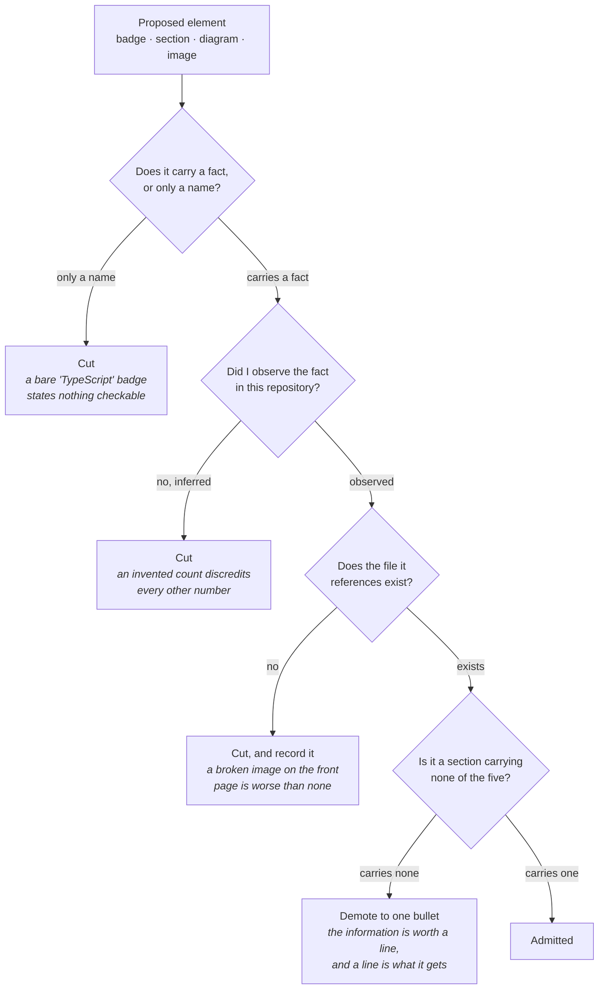

<div align="center">

# Showcase

**A Claude Code skill that writes your README after running your project — not after reading your
folder names. Every number in what it produces is one it observed, and anything it could not
observe it tells you it could not observe.**

Seven reference files and one workflow, in plain Markdown.
**No dependencies, no build step, no runtime. Nothing executes at install; the skill runs your
project's tests or dev server only after its run-safety gate.**


<a href="LICENSE"></a>


<a href="#run-it">Run it</a> ·
<a href="#see-the-result">Result</a> ·
<a href="#cost-and-safety">Cost and safety</a> ·
<a href="SKILL.md">Skill</a> ·
<a href="CHANGELOG.md">Changelog</a>

</div>

---

## Run it

There is nothing to run at install. It is Markdown that Claude Code reads. Install as a plugin:

```bash
/plugin marketplace add DahanItamar/SkillShelf
/plugin install showcase@skillshelf
/reload-plugins
```

Or copy only the skill (`SKILL.md` and `references/`) into place:

```bash
git clone https://github.com/DahanItamar/SkillShelf.git
mkdir -p ~/.claude/skills/showcase
cp SkillShelf/plugins/showcase/SKILL.md ~/.claude/skills/showcase/
cp -r SkillShelf/plugins/showcase/references ~/.claude/skills/showcase/
```

The marketplace route is preferred. Both work because `SKILL.md` sits at the plugin root and every
path it names is relative to itself. To confirm it loaded, ask Claude whether the showcase skill
is available. The first prompt to try is *"write a README for this"*.

Safety, in one sentence: it runs your tests only on your own repository or after you confirm, and
if you do not confirm it executes nothing. Say "do not run anything" for a read-only pass.

`docs/` is for maintainers and is never loaded at run time. `CHANGELOG.md` is this plugin's
history, and `check.sh` is a maintainer-run script that rechecks the numbers on this page.

## See the result

[Winnow](https://github.com/DahanItamar/Winnow) is the README this skill's style is derived from,
and the worked example to read. It is the style source named in
[`docs/SPEC.md`](docs/SPEC.md); this repository holds no generated before/after pair, and none is
shown here because none was verified.

Ask in your own words, for example:

- *"write a README for this"*
- *"my README is out of date, audit it"*
- *"audit my README without changing it"* (audit only, writes nothing)
- *"make this presentable before I make it public"*

Not for: a `CHANGELOG`, a `CONTRIBUTING` guide, or API reference docs, in the repositories it
documents; this plugin keeps its own.

## Cost and safety

- **Cost.** `SKILL.md` is 18,897 bytes at 2.2.0 (about 4.7k tokens at 4 bytes per token) and loads on every
  run. The seven reference files total 52,533 bytes and load only at the phase that needs them. A
  utility run that skips `identity-block.md` and `visuals.md` loads `SKILL.md` plus five
  references, 51,593 bytes (about 12.9k tokens). A run that loads everything is 71,430 bytes (about
  17.9k tokens). Audit only loads `SKILL.md` plus the few files the README points at. The stranger
  test is offered, not default: it spawns a subagent that repeats the setup path and roughly doubles
  the run's token cost. Sizes measured with `wc -c` at 2.2.0 and rechecked by `check.sh`. No end-to-end run cost was
  measured; the figures above are load size only. The stranger test and Phase 1 execution add to it.
- **Safety.** Phase 1 runs the project, which executes its code. Tests run only if the repository
  is yours or you confirm; if ownership is unclear it asks once. It checks the manifest and CI for
  service dependencies first, asks before network, paid, remote-database, migration, deploy or
  credential-bearing steps, reads `.env.example` and never `.env`, and stops what it started. With
  no confirmation it executes nothing and writes from the tests, marking runtime facts `unverified`.
  The gate is a prompt-level rule, not a sandbox: run unfamiliar repositories in a container or VM.
  It also pairs with, and does not replace, an existing README drift linter.

## Limits

- The port check has a command per OS (Linux, macOS, Windows PowerShell); if none works it is
  marked `unverified`.
- With no tests, it writes from the examples.
- If the project needs credentials, those facts are `unverified`.
- Badge URLs in the READMEs it writes may carry `&logo=`. The no-logo rule applies only to this
  marketplace's own README badges.

## Why most generated READMEs are adjectives

Ask a model for a README and it reads the directory, infers what the project probably does, and
writes *"robust error handling"*, *"clean architecture"*, *"blazing fast"*. Every one of those is
unfalsifiable, which is another way of saying it carries no information. The reader learns nothing
and — worse — learns that this README is the kind that carries nothing.

This skill's entire design follows from one rule:

> **Show it. Never describe what a reader could be shown.**

*"Handles concurrent requests safely"* is an assertion. *"Two arrivals reach the runway exactly one
tick apart (07:11:51 → 07:11:56) — one at a time, enforced by the queue"* is evidence, and it comes
with the timestamps to check it. The first is free to write. The second requires running the thing.

So the workflow runs the thing. It reads the manifest, the entry point, the tests and
`.env.example`; it starts the project, hits an endpoint, runs the suite; and only then does it
write. Where it genuinely cannot run something — no credentials, no hardware, a paid service — it
says so to you and writes from the tests instead, carrying no timings and no screenshots, because
those would have to be invented.

## Nothing gets in because it would look right there

The failure mode of every README template is that it has slots, and slots get filled. A badge row
gets badges. A screenshot section gets a screenshot. The document ends up shaped like a good README
without being one.

So every element faces an admission test with a stated condition, and failing it means removal —
not padding until it looks sufficient.



The five a capability section may carry: **a diagram, a table, real program output, a measured
number, or an image.** Not a well-written paragraph, not a list of sub-features, not a claim that
the approach is unusual — those are the raw material of a section, not a section.

**This README is the worked example.** It has no CI badge and no test-count badge because this
repository has neither a pipeline nor a suite; it has no hero image because none was produced.
Three badges, all checkable. That is what the test produces when it is applied honestly, and it is
why no reference file holds a fabricated sample.

## What it writes, and what it refuses to

| Writes | When |
|---|---|
| `README.md` | Always |
| `docs/SETUP.md` | Setup needs more than the commands that fit in Run it |
| `docs/ARCHITECTURE.md` | The mechanism needs more room than one section |
| `docs/brand/*.svg` | A typographic wordmark, light and dark — never a pictorial mark |
| `docs/assets/screens/*.png` | Capture succeeded |
| `docs/SCREENSHOTS.md` | Capture failed, was impossible, or you declined |
| `docs/EVIDENCE.md` | You accept the evidence table (claim, command, output, date); a later run replays it and edits only stale facts |

That list is the whole write surface. It creates no `CONTRIBUTING.md`, no `CHANGELOG.md`, no
`ROADMAP.md` in the repositories it documents unless you ask by name — a visitor did not open your repository for its process, and
an empty process file reads as a template somebody forgot to finish.

> [!IMPORTANT]
> **It never runs a git command that writes.** No commit, no push, no tag. It produces files;
> whether they enter your history is a decision you make after reading them. It also redacts any
> secret, token or personal name found in real output before writing it, and marks the
> redaction — because an unmarked redaction is a fabricated line.

## Screenshots are asked about, never guessed

Whether your project is a page at a URL, a desktop window, or a terminal session — and whether it
needs credentials or staging into a particular state — are facts you have and the skill does not.
So it asks, offering the mechanisms that fit what it found, plus a custom option where you write
the instruction yourself.

When capture fails or you decline, it writes `docs/SCREENSHOTS.md`: for each shot, the filename,
what must be visible, how to stage it, and where it goes in the README. Then it tells you plainly
that this was the one thing it could not do. **It never references an image it did not produce.**

## Under the hood — briefly

- **Progressive disclosure.** `SKILL.md` is 326 lines and loads every invocation; the seven
  reference files are 1,155 lines and load only at the phase that needs them. A reference file is
  read cold and alone, so each is complete by itself and none depends on another being loaded.
- **Audit first.** If a README exists, the skill shows a keep / change / cut table before writing,
  and offers an audit-only mode that writes nothing and does not run the project.
- **Badges are tested, not banned.** v1 forbade badge rows outright. That ban was a proxy for
  *badges usually carry nothing*, and the proxy failed on `runtime deps 1`, which carries the most
  interesting fact about a project. So the rule now tests the badge, not the row.
- **Mermaid ahead of any image format.** It renders on GitHub, it is plain text in the diff, it
  needs no file to rot, and where it does not render it degrades to readable source rather than to
  a broken image.
- **Nothing executes at install.** No dependencies, no build, no scripts. Installation is a file
  copy, and a repository that only contains Markdown is one you can audit before running it.

> Provenance: this skill was built by its own spec chain. [`docs/CONSTITUTION.md`](docs/CONSTITUTION.md)
> holds the rules, [`docs/SPEC.md`](docs/SPEC.md) records why each decision beat its alternative, and
> [`docs/changes/`](docs/changes) holds the task lists. Read them before changing anything.

---

<div align="center">

Built by <a href="https://github.com/DahanItamar">Itamar Dahan</a> · <a href="LICENSE">MIT</a> · © 2026

</div>
